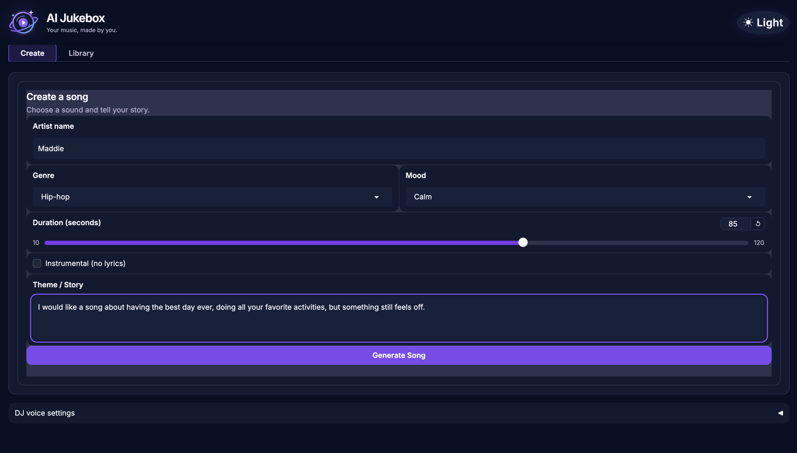
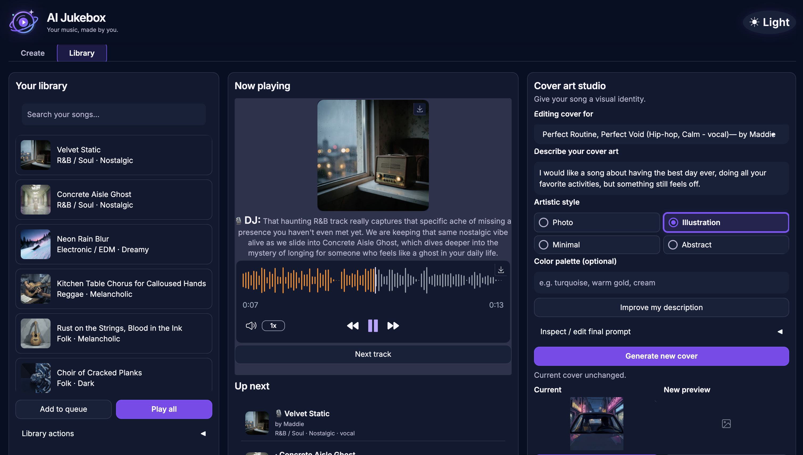
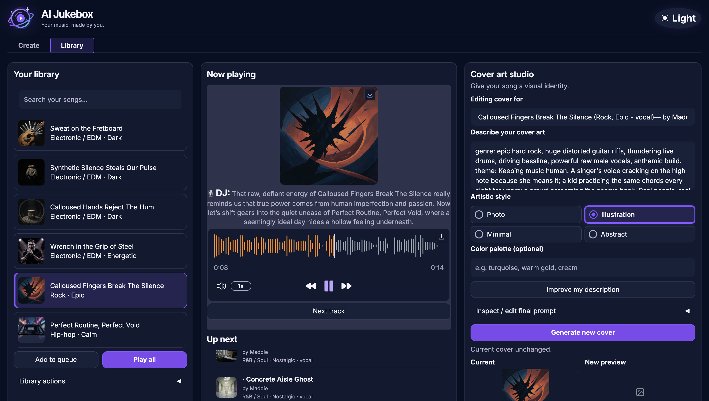
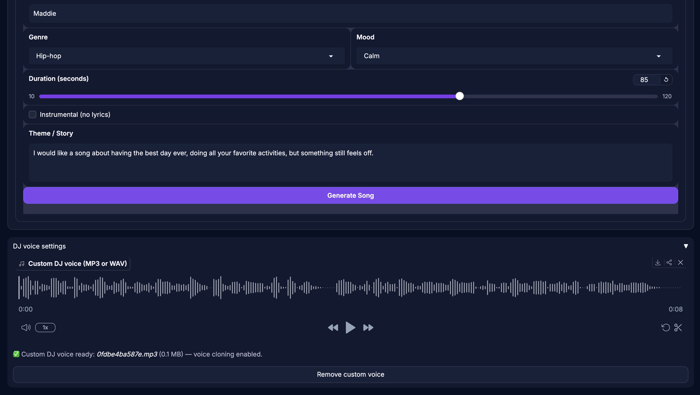

# AI Jukebox 🎵

Generate original songs with matching cover art, and let an AI DJ add spoken
commentary between tracks. A Gradio app powered entirely by the class AI
services (no paid services, no port 9000).

## Status

Core features tested manually through the live Gradio app on macOS with a real browser (Chrome). Results and known issues are documented in the tables below. The automated tests pass.

## Features

1. **Custom song generation** — pick a style, mood, duration (10–120 s slider,
   enforced 10–120 s in code), instrumental or vocal, and an optional theme.
   Qwen writes the title (and original lyrics for vocal tracks, shown in the
   UI), ACE-Step composes the audio, and the song lands in the library
   immediately with live stage updates and elapsed time.
2. **Matching cover art** — Qwen writes a FLUX-safe prompt (no text, logos,
   real people, or copyrighted characters) and FLUX.2 klein 4B generates the
   cover, stored with the song in the library, queue, and now-playing view.
   Covers can be regenerated anytime in the **Cover Art Studio**.
3. **AI DJ** — between queued songs, Qwen writes 2–3 sentences of commentary
   that names both songs (title, style, mood, lyric theme), and Chatterbox
   speaks it. Clips are **prefetched while the current song plays** and cached
   per song pair for the session.

   **DJ Voice:** By default the bundled Chatterbox voice is used automatically.
   To customize the DJ's voice, upload a short audio recording as a reference.
   Supported formats: MP3 and WAV. If usage fails, the DJ falls back to the default
   voice and displays a notice. The voice reference must be 3–60 seconds long;
   shorter or longer files are rejected. Recorded references are stored only in
   the gitignored `data/voice_refs/` directory and can be removed at any time.
4. **Player & queue** — a single `gr.Audio` plays songs and DJ clips
   sequentially (song → DJ clip → song → …) via a state machine in `gr.State`,
   advanced on the audio component's end event. Play/pause on the player,
   **Next track** (works during both a song and DJ speech), a visible queue with a
   now-playing indicator, "add to queue" for any library song, and **Play all**.
   The library persists across server restarts (`data/library.json`).

## Requirements

- Python **3.10 or newer** (tested on Python 3.14.6 on macOS)
  - macOS's built-in `python3` (version 3.9) is too old for this project.
    Install Python from [python.org](https://www.python.org/downloads/macos/)
    (the macOS installer package works well), then create a virtual environment:

    ```bash
    python3 -m venv .venv
    source .venv/bin/activate
    pip install -r requirements.txt
    ```

On Windows, activate with `.venv\Scripts\activate`.

- **ffmpeg** is required for audio validation (checking voice clip length)
  - **macOS:** `brew install ffmpeg`
  - **Windows:** Download from [ffmpeg.org](https://ffmpeg.org/download.html)
    or use `choco install ffmpeg`, then add to your PATH, or download the
    static build and place `ffmpeg.exe` somewhere on your PATH.

## Quick start

```bash
source .venv/bin/activate    # activate the virtual environment
cp .env.example .env         # then set LLM_API_KEY to your class key
python app.py                # -> http://127.0.0.1:7860
```

### Windows launch and port conflicts

Double-click `launch.bat`. It opens an already-running AI Jukebox instead of starting a duplicate. If no instance is running, it starts the app, waits until it is ready, and opens **http://127.0.0.1:7860** automatically. Keep the server console open; use **Ctrl+C** there when you want to stop it. An unrecognized service on the port is left untouched.

`app.py` explicitly passes `server_name="127.0.0.1"` and `server_port=7860` to `app.launch()`. Setting `GRADIO_SERVER_PORT` alone does not override the explicit argument. If another application needs 7860, identify that process first; do not kill an unknown listener. Choose an available local port in `app.launch()` and update the URL in `launch.bat` accordingly. The local UI port is separate from the class service endpoints—do not change those to fix a local port conflict.

Configuration comes from environment variables or the gitignored `.env`.
The app fails fast at startup if `LLM_API_KEY` is missing. Base URLs default
to the class endpoints and can be overridden per service (see `.env.example`).

## Class services used

| Port | Service | Job in this app |
| --- | --- | --- |
| 9001 | Qwen3.6-35B-A3B (`cyankiwi/...-AWQ-4bit`) | titles, lyrics, cover prompts, DJ commentary |
| 9006 | FLUX.2 klein 4B (`black-forest-labs/...`) | cover art |
| 9007 | ACE-Step 1.5 XL Turbo | music generation |
| 9008 | Chatterbox Multilingual V3 | DJ speech (default voice / voice cloning) |

All request formats were verified against the live services (see `PROGRESS.md`).

## How to use

### Song generation
1. Open the app at http://127.0.0.1:7860 and go to the **Create** tab.
2. Optionally enter an artist name. Pick a genre (or type your own) and a mood, set the duration (10–120 s), and leave **Instrumental** unchecked for a vocal song.
3. Optionally describe a theme in **Theme / Story**.
4. Click **Generate Song**. The status box shows each stage (writing lyrics, generating the song, creating cover art) with a timer.
5. The finished song is added to the **Library** with its title, cover, and lyrics.

### Cover art
1. Go to the **Library** tab. In the **Cover art studio**, choose the song under **Editing cover for**.
2. Describe the cover you want, pick a style (Photo, Illustration, Minimal, Abstract), and optionally a color palette.
3. Click **Improve my description** to have Qwen refine the prompt, then **Generate new cover** to preview a new FLUX image.
4. Click **Use this cover** to save it to the song, or **Keep current** to discard it. The audio is never changed.

### AI DJ
1. Make sure the library has at least two songs (the shipped sample counts).
2. Check that **DJ between songs** is on under **DJ options** in the Library tab (it's on by default).
3. Click **Play all** once. Songs play in order, and between songs the DJ speaks about the song that just ended and the next one, then the next song starts automatically. **Next track** skips ahead.
4. Optional: to give the DJ a different voice, open **DJ voice settings** at the bottom of the Create tab and upload a 3–60 second MP3 or WAV of clear speech.

## Screenshots

**Song generation** (Create tab)


**Library view** with a generated track


**AI DJ commentary** playing between songs


**DJ voice settings** — custom MP3 or WAV upload


## Test results

### AI DJ

Tests performed on macOS with Python 3.14.6, connected to live class services
(ports 9001 and 9008). Script-based validations ran via `jukebox.service` in a
test harness; manual tests were run through the live Gradio app.

| Input | Expected | Actual | Status |
| --- | --- | --- | --- |
| Play all with 2+ songs, default DJ voice | Song → DJ commentary → next song, automatic | Song → DJ commentary about both songs → next song, automatic; commentary text shown under player | Verified |
| Skip during DJ speech | Jump to next song without overlap | Jumped to next song, no overlapping audio | Verified |
| Custom voice, MP3 (user recording) | DJ uses user's voice clone | DJ sounded like the user | Verified |
| Custom voice, WAV (user recording) | DJ uses user's voice clone | DJ sounded like the user | Verified |
| Custom voice, .m4a (iPhone Voice Memo) | Rejected — not a supported format | File picker allows .m4a, but nothing happens — no file shown, no error. Known issue; use MP3 or WAV. | Known issue |
| Unsupported format (.txt) dragged onto voice box | Clear warning: only MP3 or WAV accepted | Clear warning displayed | Verified |
| Invalid voice reference (~2 s short) | Rejected with "must be 3–60 seconds" message | Rejected, clear error shown | Script verified |
| Invalid voice reference (~65 s long) | Rejected with "must be 3–60 seconds" message | Rejected, clear error shown | Script verified |
| Custom voice engine failure (invalid/non-speech audio) | Fall back to default voice, show gr.Warning | Fallback triggered on any exception, gr.Warning displayed | Script verified |

### Song generation

Tests performed manually through the live Gradio app on macOS with a real
browser (Chrome), connected to live class services (ports 9001 and 9007).

| Input | Expected | Actual | Status |
| --- | --- | --- | --- |
| Vocal song, 10 s duration | Generated track with some singing | Generated, but no audible singing — output is instrumental only | Known issue |
| Vocal song, 35 s duration | Generated track with clear singing | Singing audible, sounded right | Pass |
| Vocal song, 100 s duration | Full lyrics sung end to end | Generated with singing; lyrics shown in the app. Not checked whether every lyric line was sung. | Pass (partial) |
| Instrumental song | Music with no vocals | Generated and played with no vocals | Pass |

### Cover art

Tests performed manually through the Cover Art Studio in the live Gradio app
on macOS with Chrome, connected to FLUX (port 9006).

| Input | Expected | Actual | Status |
| --- | --- | --- | --- |
| Regenerated sample cover in Cover Art Studio, Abstract style, custom description and palette | Accept artwork and display it on the track | Accepted; cover shown on track in both Library and player | Pass |

### Fresh download

| Input | Expected | Actual | Status |
| --- | --- | --- | --- |
| Clone repo from GitHub, start `python app.py` | Sample songs appear in library automatically | Samples appeared in library with covers | Pass |

Tested on a fresh clone in a separate environment; a teammate install from the
GitHub ZIP is still to be done.

### Automated tests

The automated tests pass (`python -m pytest tests`); they run offline and don't call the class services. `scripts/smoke_test.py` checks the live class services.

### Live-service smoke test

`scripts/smoke_test.py` exercises every feature path against the live class
services (see `PROGRESS.md` for the results and for the two Gradio-6-specific
findings: `theme`/`css` go to `launch()` not `Blocks()`, and the audio end
event is exposed as the `stop` event).
Last run during the initial build (see PROGRESS.md); not rerun for this version.

## Limitations

- **Short vocal songs:** the music model sings only what fits the duration, so ~10 s vocal tracks may have little or no singing. Use 30 s or more for clear vocals.
- **Voice file formats:** voice uploads accept MP3 and WAV. Other formats such as .m4a are ignored without a message, so convert them first.
- **Browser coverage:** autoplay was tested in Chrome on macOS.
- **Generation varies:** each generation is random, and sound and lyric quality don't always line up. Generating a few takes and keeping the best works better than rewriting the prompt.
- **Theme length:** short, concrete themes produced better songs than long, detailed instructions.

## Design judgment

**Prefetching DJ clips while the current song plays, rather than generating
them on demand, avoids silence between tracks.** A single DJ clip takes
approximately **4.6 seconds** to generate end-to-end (measured via timing
the Qwen + Chatterbox pipeline during live testing). If we generated the
commentary only when a song ended, listeners would hear a noticeable gap
between songs. Prefetching in a background thread keeps the transition
seamless and costs no additional time overall because generation happens in
parallel with playback.

## Sample songs

`samples/` holds ready-to-play songs that ship with the repository (they
must appear in the submission ZIP, unlike generated songs in the gitignored
`data/`):

```
samples/
  audio/         sample MP3s
  covers/        sample cover PNGs
  samples.json   manifest: id, title, style, mood, duration_sec,
                 instrumental, theme, lyrics, created_by, cover_prompt,
                 and the audio/cover filenames
```

At startup the app registers every sample in `samples.json` that is not
already in the library — matched by its fixed id, pointing at the files in
place. Nothing is copied into `data/`, and restarting never duplicates a
sample. Samples whose audio or cover file is missing are skipped with a
logged warning, and deleting a sample from the Library tab removes only the
library entry, never the files in `samples/`.

To turn a locally generated song into a sample:

```bash
python scripts/add_sample.py "<song id or title>"
```

The script looks the song up in `data/library.json` (id, exact title, or a
unique title match), copies its MP3 and cover into `samples/`, and appends
its metadata to `samples.json`. Only the song's own audio and cover are
copied — voice references, DJ clips, and everything else in `data/` are
never touched. Re-running it for the same song replaces the existing entry
in place. Commit `samples/` afterwards so the sample ships in the ZIP.

## How the sample songs were made

Each sample was generated through the app itself — the Create tab ran the
same pipeline any user song runs, using only the class AI services: **Qwen
(port 9001)** wrote the title and lyrics, **ACE-Step (port 9007)** composed
the audio, and **FLUX (port 9006)** produced the cover art.

### Sample 1 — "Calloused Fingers Break The Silence" (id `b206632d8cc0`)

- **Genre (dropdown):** Rock
- **Mood:** Epic — **vocal** — **duration:** 100 s
- **Theme (summary):** Epic hard rock with a theme of keeping music human: real voices and passion versus perfect but empty music
- **Selection process:** about 20 generations were run for this track; the best-sounding take was kept.
- **Cover:** regenerated afterwards in the Cover Art Studio — **Abstract**
  style. The final FLUX prompt is stored in `samples.json` (`cover_prompt`).
- **Assets:** `samples/audio/b206632d8cc0.mp3`, `samples/covers/b206632d8cc0.png`

### Sample 2 — "Wet Nose Lick The Counter Edge" (id `bb324da91efb`)

- **Genre (dropdown):** Folk
- **Mood:** Calm — **vocal** — **duration:** 30 s
- **Theme (as entered in the Create tab):** A black labrador puppy trying to steal food all the time.
- **Cover:** generated with FLUX — **Photo** style, depicting a black Labrador puppy at a kitchen counter. The final FLUX prompt is stored in `samples.json` (`cover_prompt`).
- **Assets:** `samples/audio/bb324da91efb.mp3`, `samples/covers/bb324da91efb.png`

### Sample 3 — "Chrome Hoof Sparkle Rush" (id `ae79df356920`)

- **Genre (dropdown):** Electronic / EDM
- **Mood:** Energetic — **vocal** — **duration:** 60 s
- **Theme (as entered in the Create tab):** Fluffy kittens chasing a unicorn through a sparkling magical theme park
- **Cover:** generated with FLUX — **Illustration** style, featuring fluffy kittens chasing a unicorn through a pixelated landscape. The final FLUX prompt is stored in `samples.json` (`cover_prompt`).
- **Assets:** `samples/audio/ae79df356920.mp3`, `samples/covers/ae79df356920.png`

## Project layout

```
app.py                  # Gradio UI + player state machine (one-command launch)
jukebox/
  config.py             # env config, paths, fail-fast startup checks
  clients.py            # HTTP clients for the four class services
  prompts.py            # prompt contracts (all-original content rules)
  service.py            # pipelines: draft, compose, cover, DJ, voice validation
  library.py            # song library with JSON persistence
  samples.py            # bundled sample loading from samples/ (tracked in git)
samples/                # ready-to-play sample songs (audio/, covers/, samples.json)
scripts/add_sample.py   # turn a generated song into a bundled sample
scripts/smoke_test.py   # end-to-end sanity checks against the live services
```
