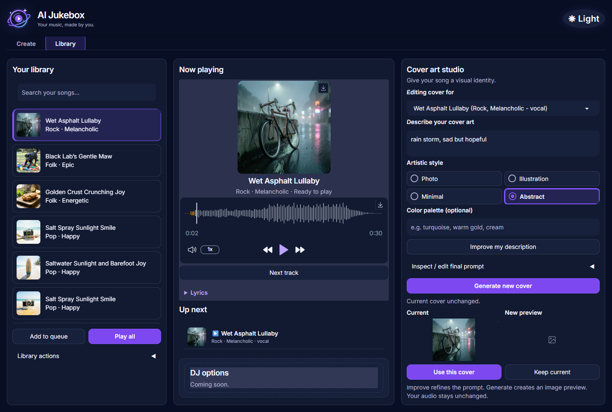
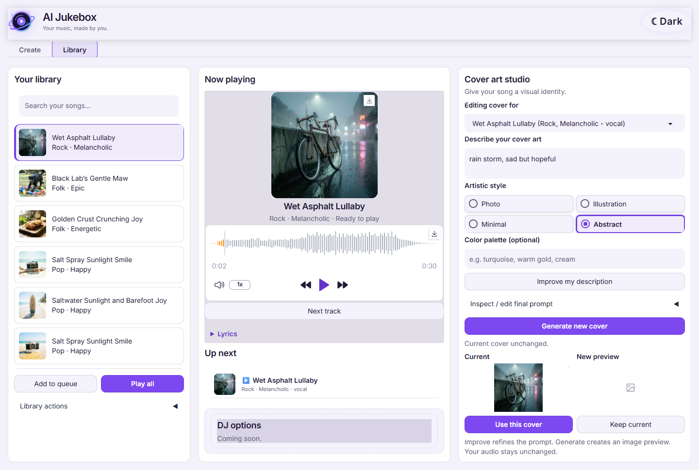
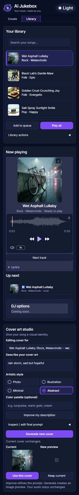
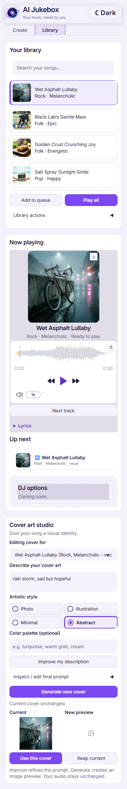

# Library and Cover Art Studio — verification report

## Changes

- Responsive Library screen: compact searchable library, Now Playing/lyrics/queue, and Cover Art Studio, without removing the Create tab.
- Navy/purple dark theme and readable light theme, compact labeled theme action, custom SVG brand mark, filled selected style radios (no duplicate checkmarks).
- Consolidated playback to the native Gradio player; retained Next track. Fitted the entire waveform to the panel rather than clipping its timeline, including resize handling and seek verification.
- Tighter spacing and smaller responsive artwork/previews. Current/New preview labels above images, empty preview toolbar configuration using Gradio 6.30's supported `buttons=[]`.
- Qwen's **Improve my description** prepares a song-aware, editable final prompt; **Generate new cover** renders a candidate. Style/description/palette edits invalidate the prepared track binding until improved again.
- Photo, Illustration, Minimal and Abstract have distinct medium requirements. Minimal explicitly asks for simplified forms, limited detail, a restrained palette and intentional negative space.
- Candidates retain original track IDs. Only **Use this cover** writes cover fields; **Keep current**, failures and mismatched-track acceptance leave saved artwork intact.
- Safe launcher uses the project virtual environment, reuses a healthy running Jukebox, and never kills an unknown port owner.
- DJ area stays reserved with “Coming soon.” No new DJ parameters or controls were implemented or tested.

## Actual verification

Environment: Windows, project `.venv`, Gradio **6.30.0**, headless Microsoft Edge through Playwright. App launched using the terminal's background process option and `launcher.py --no-browser`; local app responded HTTP 200.

### Automated unit/component tests

**26 selected tests passed**, covering brief construction, exact edited-prompt forwarding, empty/error responses, candidate generation/rejection/acceptance and track guards, native UI component contracts, filtered song-ID mapping, missing-audio output arity, deletion regressions, brand mark, launcher reuse and unknown-listener safety, and medium-specific prompt requirements.

DJ-specific tests and the reserved-DJ-space contract test were intentionally excluded at the user's request. The existing `test_playback_flow.py` was not included in this PR or run as part of this verification.

### Browser tests

- `python tests/check_polished_ui.py` — **passed**. Native play/pause resumes without resetting, full waveform fits and seeking at 75% maps to approximately 75% of audio duration, no horizontal overflow, single playback UI, above-image labels and empty icon toolbars. Checked 1440, 1024, 768 and 390 pixel viewports in dark and light themes. At 1440×900, cover acceptance actions are within the viewport. No page JavaScript errors.
- `python tests/check_cover_studio_browser.py` — **passed** using an isolated temporary library, actual WAV files and deterministic service doubles. Acceptance writes only original track's cover fields; rejection leaves artwork unchanged; injected generation failure allows retry; switching cover tracks during an in-flight request blocks wrong-track acceptance. Player audio source, audio-file hashes and queue stayed unchanged. Real saved library checksum unchanged. Fixture images are generated locally, not downloaded or copied from private artifacts.
- `python tests/check_library_ui_browser.py` — **passed** against the local app. Three song selections plus repeat click and exact search mapping, correct title/artwork/lyrics, audio loading, Create-tab availability, theme persistence and stacked narrow layouts. Saved library unchanged. The test was hardened to resolve/fetch the current media source in one browser operation instead of racing revocation of an old blob URL.
- A separate native playback regression is available as `python tests/check_playback_sync.py`.

### Live model evidence from implementation

Real Qwen requests for the same song/description returned four distinct style prompts. Minimal contained simplified forms, limited detail and negative-space requirements. Existing FLUX request fields were checked against the class server's live OpenAPI schema; no new undocumented image settings were introduced. A before/after FLUX image comparison was reviewed during implementation; no universal quality improvement is claimed. New image generation was not rerun just to create this PR.

### Contrast and preservation

Measured theme text/panel contrast: dark **15.87:1**, light **16.47:1**. Primary button white-text contrast in the served screenshots: **5.19:1**. This is targeted contrast verification, not a complete accessibility audit.

All **84** pre-polish saved data files matched their recorded hashes after verification. No credentials, `.env`, uploads, generated audio, saved library data, logs, checkpoints or scratch files are included in this PR. Screenshots show existing art as requested, not standalone media uploads.

## Review fixes verified before PR

- Search/refresh clears the destructive-action selection, so a hidden formerly selected track cannot be deleted. Audio and queue outputs are not touched by filtering.
- A single per-session load callback reads the current library, including songs added after the server started, instead of restoring a build-time snapshot. Empty-library initialization is covered.
- Keep current is disabled while cover rendering is in flight and re-enabled afterward, including handled failures. Browser regression checks this during a deliberately slow request.

## Limits / remaining review

- DJ controls, speech/music transitions and teammate-owned parameters were deliberately not tested or changed in this task.
- Fresh live music generation and live FLUX generation were not rerun for PR packaging. Controlled cover-service failure/timing cases use test doubles and are labeled as such.
- Gradio has emitted Windows event-loop ResourceWarnings and connection-reset messages on closing browser sessions in earlier runs; no failed application callback or page error was observed in the passing final browser suites.
- Browser scripts expect a configured `.env`, installed project dependencies, Playwright with Microsoft Edge available, and saved songs for the live-library checks. The app never sends ratings/credentials into UI diagnostics.
- CI status is reported separately on the PR; local passing tests do not imply GitHub CI ran.

## Screenshots

### Desktop — dark


### Desktop — light


### Mobile
| Dark | Light |
| --- | --- |
|  |  |

## Reproduce selected unit tests without DJ tests

```python
import unittest
names = ['test_cover_brief', 'test_cover_studio_ui', 'test_launcher',
         'test_library_layout', 'test_delete_song', 'test_ui_polish', 'test_brand_mark']
suite = unittest.defaultTestLoader.discover('tests', pattern='test_*.py')
selected = []
def collect(items):
    for test in items:
        if isinstance(test, unittest.TestSuite):
            collect(test)
        elif any(test.id().startswith(name + '.') for name in names) and 'teammates_dj_controls' not in test.id():
            selected.append(test)
collect(suite)
result = unittest.TextTestRunner(verbosity=2).run(unittest.TestSuite(selected))
raise SystemExit(not result.wasSuccessful())
```
